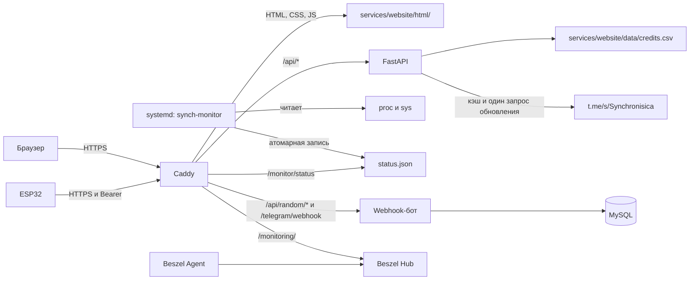

# Synchronisica

Сайт, Telegram webhook-бот с MySQL, панель Beszel и сборщик метрик ESP32 находятся
в одном репозитории. Python-сервисы объединены в uv workspace с общим `uv.lock`.
Сборщик ESP32 работает независимо от сайта, бота и панели.

## Архитектура



| Каталог | Ответственность |
| --- | --- |
| `services/website/` | API визитки, HTML/CSS/JS, музыкальный список и кэш Telegram |
| `services/random_telegram_bot/` | Каталог, команды Telegram, очередь и миграции MySQL |
| `services/monitoring/` | Сбор метрик хоста, проверки свежести, systemd и установка |
| `esp_software/` | Прошивка, версии библиотек и шаблоны настроек |
| `deploy/caddy/` | HTTP/HTTPS, защитные заголовки, доступ к метрикам |
| `scripts/`, `tests/` | Подготовка, проверки и регрессионные тесты |
| `.local/` | Приватные данные входа, резервные копии и создаваемые результаты проверок |

## Запуск

Нужны Python 3.13 и uv. Для проверок JavaScript нужен Node.js; для браузерных
проверок установленный Chrome. Python-пакеты закреплены в `uv.lock`.

```powershell
uv sync --locked
uv run --locked uvicorn app.main:app --host 127.0.0.1 --port 8080
```

Открыть `http://127.0.0.1:8080`. Для этого способа разработки FastAPI раздаёт статику.
Настройки описаны в `.env.example`. Uvicorn не читает `.env` автоматически: при
необходимости создайте его из примера и добавьте `--env-file .env` к команде запуска.

С Docker статику раздаёт Caddy; код приложения автоматически перезагружается:

```powershell
uv run --locked python -m scripts.stack --dev up -d --build --wait
```

По умолчанию HTTP доступен только на `127.0.0.1:8080`.
Для полного Docker-стека также нужен приватный `.env.integration` с настройками
MySQL и webhook: скопируйте `.env.integration.example` и замените пароли и секреты.
Состав переменных описан в [инструкции эксплуатации](docs/OPERATIONS.md).

## Проверки

```powershell
uv run --locked python scripts/check.py
uv run --locked python scripts/check.py --audit
uv run --locked python scripts/check.py --browser --url http://127.0.0.1:8080
uv run --locked python scripts/check.py --docker
uv run --locked --group browser python -m scripts.check_integration_browser
```

Базовая команда проверяет lockfile, Ruff, форматирование, pytest, ty и JavaScript.
Группа `browser` подключается для проверки типов Playwright; браузер запускается
только с `--browser`. `--audit` обращается к базе уязвимостей. `--docker` требует
запущенного Docker и собирает приложение. Ошибка любой проверки останавливает сценарий.

Браузерные проверки используют тестовые ответы Telegram, проверяют ширины 320–1920 px,
сенсорную прокрутку, увеличение текста, reduced motion, GIF/MP4 и отказ API.
Снимки сохраняются в `.local/screenshots/`. Для проверки CSP используйте URL через Caddy.

## Production

На Ubuntu установите Docker через `deploy/bootstrap-server.sh`, настройте DNS для
домена и `www`, создайте `.env` из `.env.example`, укажите `SITE_DOMAIN`.

```sh
python3 -m scripts.stack config --quiet
python3 -m scripts.stack ps
```

`scripts.stack` подключает все production overlays и три приватных файла настроек.
Обновление отдельного сервиса выполняйте после бэкапа и проверок:

```sh
python3 -m scripts.stack up -d --no-deps --build --wait bot
```

Миграции выполняются отдельным шагом до запуска нового образа; см.
[инструкцию эксплуатации](docs/OPERATIONS.md). Перед обновлением сохраняйте `.env`,
`.env.monitor`, `.env.integration`, БД, историю Beszel и состояние Caddy.
На текущем VPS uv не установлен на хосте. Серверные скрипты управления используют
системный Python без сторонних зависимостей; локальные проверки и сборки контейнеров используют uv.
Не публикуйте `docker compose config` без `--quiet`: вывод может содержать токен.
Подготовка ESP32 и установка службы описаны в [MONITORING.md](MONITORING.md).

## Перед коммитом

В Git входят исходники, миграции, шаблоны конфигурации и рабочие проверки.
`.env`, `.env.integration`, `.env.monitor`, приватные заголовки ESP32 и весь `.local/`
исключены. После изменения сервисов запускайте общую проверку выше; после изменения
прошивки также выполняйте её сборку и тест состояния из [MONITORING.md](MONITORING.md).
